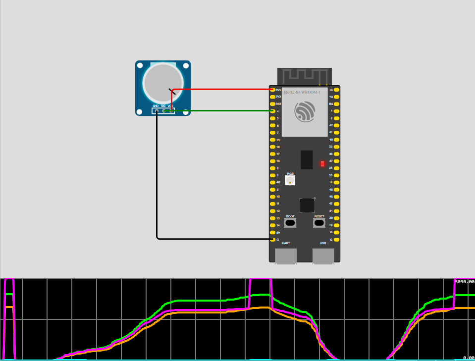
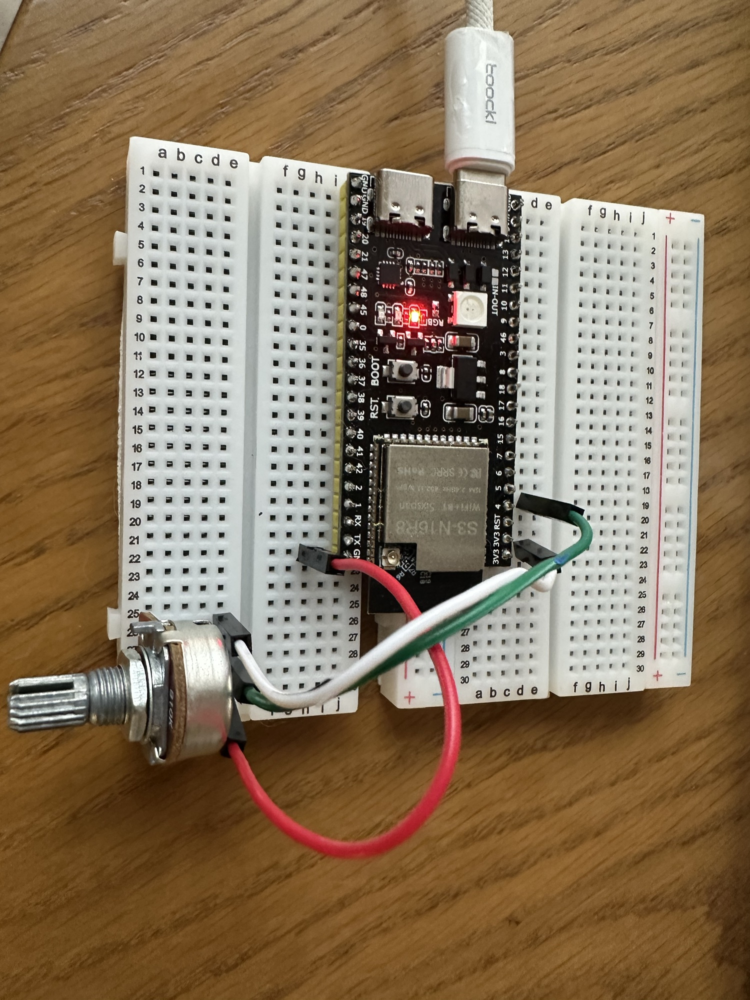
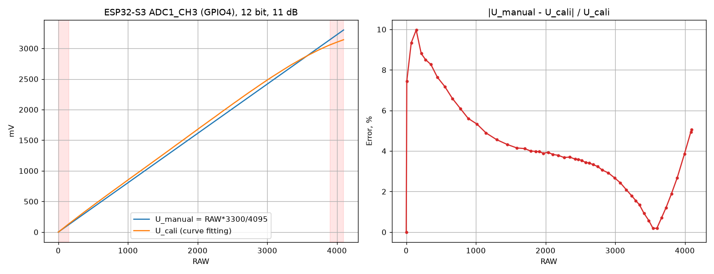

# Модуль 3.2 — Калібрування даних з ADC

Beetroot Academy, Embedded Development — Модуль 3, урок 2.

ESP32-S3 зчитує напругу з потенціометра (подільник напруги) через ADC1 у режимі **oneshot** кожні 100 мс.
Для кожного вимірювання напруга обчислюється двома способами — вручну за формулою та через **калібрований ADC**
(схема curve fitting з даними eFuse), — і рахується похибка між ними.

## Обладнання
- ESP32-S3-DevKitC-1 (N16R8)
- Потенціометр 10 кОм

## Підключення
| Вивід потенціометра | ESP32-S3 |
|---|---|
| Крайній 1 | **3V3** |
| Середній (бігунок) | **GPIO4** (ADC1_CH3) |
| Крайній 2 | **GND** |

```
3V3 ──┐
     [10k]◄── бігунок ── GPIO4 (ADC1_CH3)
GND ──┘
```





## Параметри ADC
| Параметр | Значення |
|---|---|
| Блок / канал | ADC1 / CH3 (GPIO4) |
| Розрядність | 12 біт (0..4095) |
| Атенюація | 11 dB (діапазон ~0..3.1 В) |
| Опорна напруга для формули | 3300 мВ |
| Калібрування | `adc_cali_create_scheme_curve_fitting` (eFuse) |
| Усереднення | 16 відліків на вимірювання |
| Період | 100 мс |

## Програмна частина
- PlatformIO, фреймворк **ESP-IDF** 5.1
- API: `esp_adc/adc_oneshot.h`, `esp_adc/adc_cali.h`, `esp_adc/adc_cali_scheme.h`

Формули:
```
U_manual = RAW * 3300 / 4095                         (мВ)
U_cali   = adc_cali_raw_to_voltage(RAW)              (мВ)
Error    = |U_manual - U_cali| / U_cali * 100        (%)
```

## Результати
Вибрані рядки з серійної консолі (повний прохід потенціометра — у `measurements.txt`):

```
RAW    U_manual(mV)   U_cali(mV)   Error(%)
--------------------------------------------
  72         58.0           64       9.34
 143        115.2          128       9.97
 447        360.2          390       7.64
1015        817.9          864       5.33
1589       1280.5         1336       4.15
2036       1640.7         1708       3.94
2522       2032.4         2107       3.54
3074       2477.2         2539       2.43
3541       2853.6         2859       0.19
3807       3067.9         3011       1.89
3994       3218.6         3099       3.86
4095       3300.0         3141       5.06
```

## Графіки
Зліва — обидві напруги залежно від RAW, справа — похибка (%). Червоним виділено ділянки нелінійності.



## Висновки
- **Середина діапазону (RAW ~1000–3000):** похибка 3–4 %. Ручна формула систематично занижує напругу,
  бо реальна характеристика ADC не є ідеальною прямою від 0 до 3300 мВ.
- **Біля нуля (RAW < ~150):** похибка до ~10 %. ADC майже не реагує на напругу нижче ~50–100 мВ,
  а різниця в кілька мВ на малих значеннях дає великий відсоток.
- **Верхня межа (RAW > ~3900):** ADC насичується — RAW досягає 4095 при реальних ~3141 мВ,
  тому формула показує 3300 мВ, а калібрована напруга — справжню.
- **RAW ≈ 3550:** криві перетинаються, похибка близька до 0.
- Висновок: для точних вимірювань слід використовувати калібрований ADC і не працювати біля країв діапазону.
