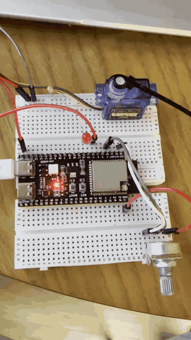
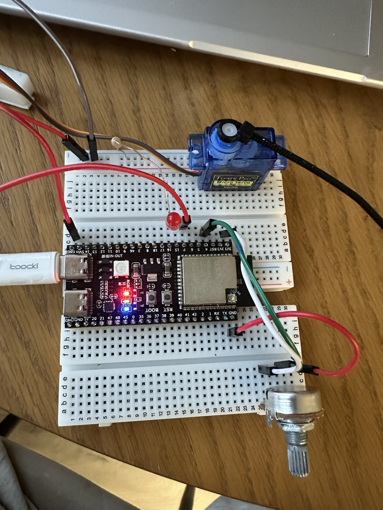
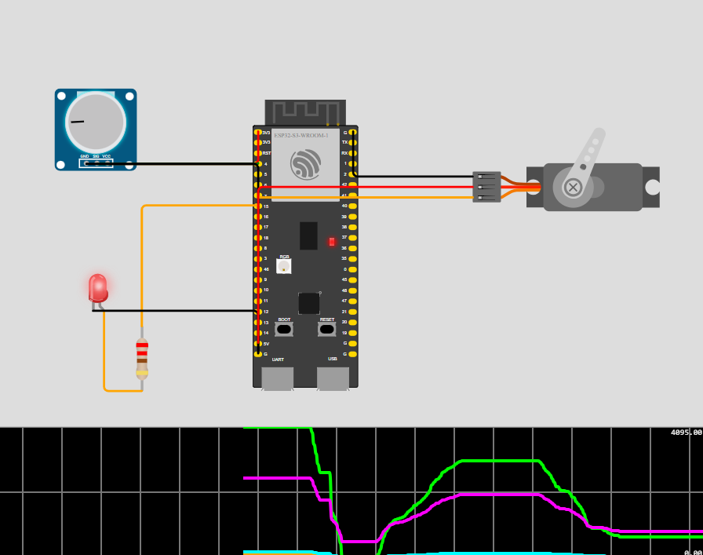

# Модуль 3.3 — Широтно-імпульсна модуляція (PWM)

Beetroot Academy, Embedded Development — Модуль 3, урок 3.

ESP32-S3 зчитує потенціометр через ADC1 і за допомогою периферії **LEDC** формує два незалежні ШІМ-сигнали:
- яскравість **світлодіода** (0–100 %);
- кут повороту вала **сервоприводу SG90** (0–180°).

Кожен вихід працює на **власному таймері та каналі LEDC** зі своєю частотою і розрядністю,
тому світлодіод і сервопривід не впливають на роботу одне одного.



## Обладнання
- ESP32-S3-DevKitC-1 (N16R8)
- Потенціометр 10 кОм
- Світлодіод + резистор 220 Ом
- Сервопривід Tower Pro SG90
- Зовнішнє джерело живлення 5 В для сервоприводу

## Підключення
| Компонент | Підключення |
|---|---|
| Потенціометр, крайній вивід 1 | **3V3** |
| Потенціометр, середній вивід | **GPIO4** (ADC1_CH3) |
| Потенціометр, крайній вивід 2 | **GND** |
| Світлодіод (анод) | **GPIO15** через 220 Ом |
| Світлодіод (катод) | **GND** |
| SG90, сигнал (помаранчевий) | **GPIO7** |
| SG90, живлення (червоний) | **+5 В** зовнішнього джерела |
| SG90, GND (коричневий) | **GND** джерела, з'єднаний з GND ESP32 |



Схема в симуляторі Wokwi (з графіком плотера):



## Параметри ШІМ
| Вихід | Таймер / канал | Частота | Розрядність | Діапазон |
|---|---|---|---|---|
| Світлодіод | LEDC timer0 / ch0 | 5 кГц | 10 біт (0..1023) | 0–100 % |
| SG90 | LEDC timer1 / ch1 | 50 Гц (20 мс) | 14 біт (0..16383) | імпульс 500–2500 мкс = 0–180° |

ADC: ADC1_CH3, 12 біт, атенюація 11 dB, усереднення 8 відліків, оновлення кожні 20 мс.

## Програмна частина
- PlatformIO, фреймворк **ESP-IDF** 5.1
- API: `esp_adc/adc_oneshot.h`, `driver/ledc.h`

Перетворення:
```
duty_led = POT * 1023 / 4095
pulse_us = 500 + POT * 2000 / 4095
duty_srv = pulse_us * 16383 / 20000
angle    = (pulse_us - 500) * 180 / 2000
```

## Результати
Фрагмент виводу в серійну консоль:
```
POT    LED_duty(%)   pulse(us)   angle(deg)
-------------------------------------------
   0          0.0         500          0.0
 542         13.2         764         23.8
1041         25.4        1008         45.7
1575         38.4        1269         69.2
2534         61.9        1737        111.3
3357         81.9        2139        147.5
3673         89.6        2293        161.4
4095        100.0        2500        180.0
```

## Висновки
- Обертання потенціометра плавно змінює яскравість світлодіода та кут сервоприводу у всьому діапазоні.
- Світлодіоду потрібна висока частота ШІМ (5 кГц), щоб не було помітного мерехтіння; сервоприводу —
  стандартні 50 Гц, де значення має ширина імпульсу (0.5–2.5 мс), а не коефіцієнт заповнення.
- Через різні частоти виходи не можуть ділити один таймер, тому використано два таймери LEDC.
- Сервопривід живиться від окремого джерела 5 В зі спільною землею, щоб його струм не просаджував живлення ESP32.
