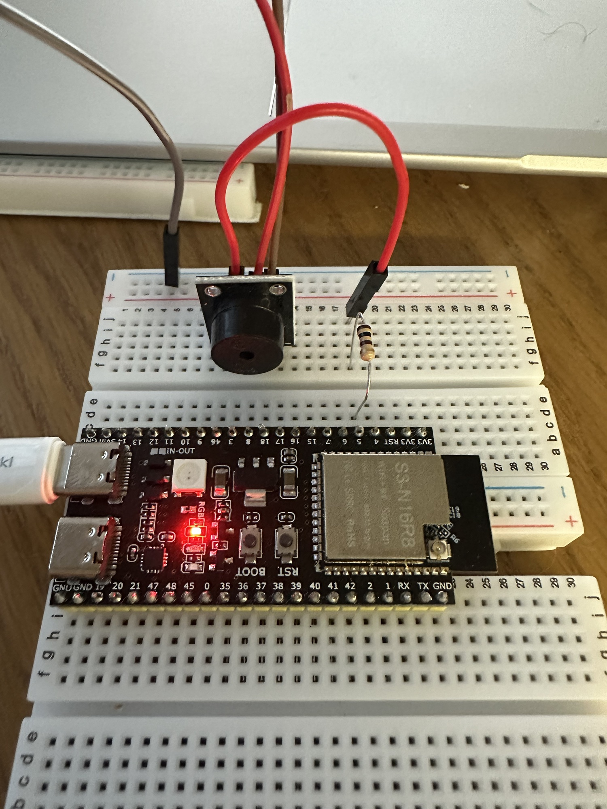
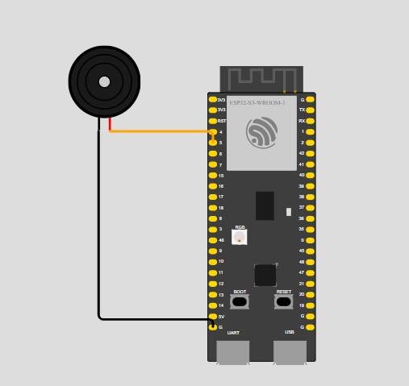
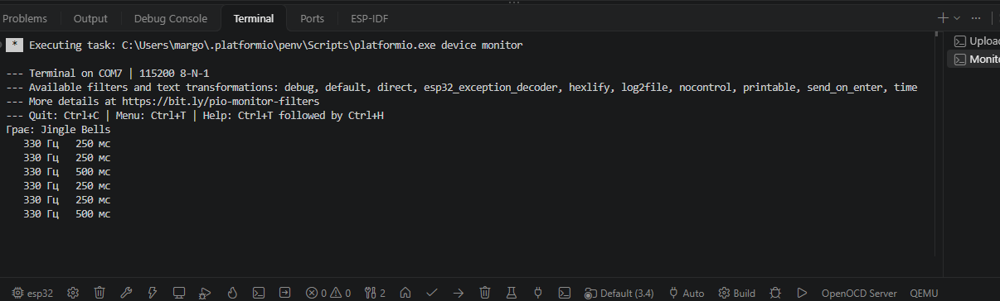

# Модуль 3.4 — Синтезатор на зумері (PWM)

Beetroot Academy, Embedded Development — Модуль 3, урок 4.

ESP32-S3 грає прості мелодії на пасивному зумері. Висота ноти задається **частотою ШІМ**
(периферія LEDC), коефіцієнт заповнення фіксований — 50 %. Пауза = duty 0.

Два режими, перемикання клавішею `m` у Serial Monitor:
- **АВТО** — по черзі грають 4 мелодії;
- **РУЧНИЙ** — клавіші `c d e f g a b C` грають 8 нот від До до До наступної октави.

## Обладнання
- ESP32-S3-DevKitC-1 (N16R8)
- Модуль пасивного зумера (S / VCC / −)
- Резистор у сигнальній лінії

## Підключення
| Зумер | ESP32-S3 |
|---|---|
| S (сигнал) | **GPIO5** через резистор |
| середній вивід (VCC) | **3V3** |
| − | **GND** |



Схема в симуляторі Wokwi:



## Ноти
| Нота | C4 | D4 | E4 | F4 | G4 | A4 | B4 | C5 |
|---|---|---|---|---|---|---|---|---|
| Клавіша | c | d | e | f | g | a | b | C |
| Частота, Гц | 262 | 294 | 330 | 349 | 392 | 440 | 494 | 523 |

## Мелодії
| Мелодія | Ноти |
|---|---|
| Baby Shark | C D E \| C D E \| C D E |
| Jingle Bells | E E E \| E E E \| E G C D E |
| We Will Rock You | C C D \| C C D \| C C D E |
| Twinkle Twinkle Little Star | C C G G \| A A G |

Мелодія — масив структур `{частота, тривалість}`. Кожна нота звучить 90 % свого часу,
останні 10 % — тиша, щоб однакові ноти, що йдуть підряд, не зливались.

## Програмна частина
- PlatformIO, фреймворк **ESP-IDF** 5.1
- `driver/ledc.h` — ШІМ: таймер0 / канал0, 10 біт, нота змінюється через `ledc_set_freq()`
- `driver/uart.h` — читання клавіш напряму з UART0 в окремій задачі FreeRTOS

## Результати
Вивід у серійну консоль:



```
Грає: Twinkle Twinkle
   262 Гц   400 мс
   262 Гц   400 мс
   392 Гц   400 мс
   392 Гц   400 мс
   440 Гц   400 мс
   440 Гц   400 мс
   392 Гц   800 мс

=== Режим: РУЧНИЙ (c d e f g a b C) ===
нота c = 262 Гц
нота d = 294 Гц
нота e = 330 Гц
нота f = 349 Гц
нота g = 392 Гц
нота a = 440 Гц
нота b = 494 Гц
нота C = 523 Гц
```

## Висновки
- Пасивний зумер відтворює ноту з тією частотою, з якою на нього подається ШІМ, тому для синтезатора
  достатньо змінювати частоту таймера LEDC.
- Duty 50 % дає максимальну гучність; duty 0 — тишу (пауза між нотами).
- Мелодії зручно зберігати як масиви `{частота, тривалість}` — нову мелодію можна додати без зміни логіки.
