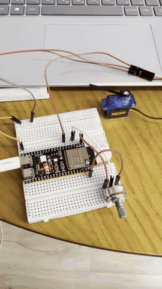
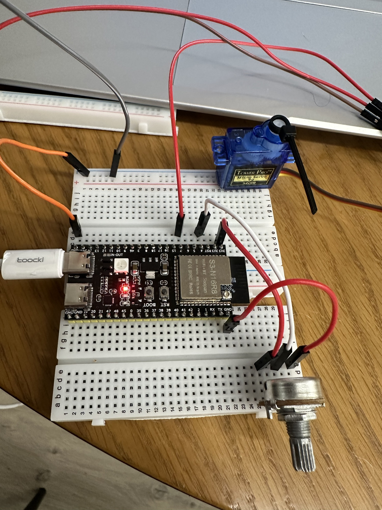
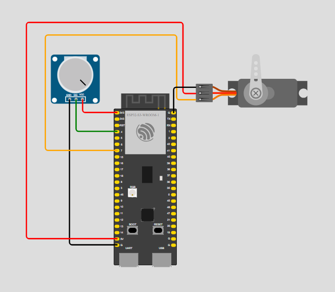
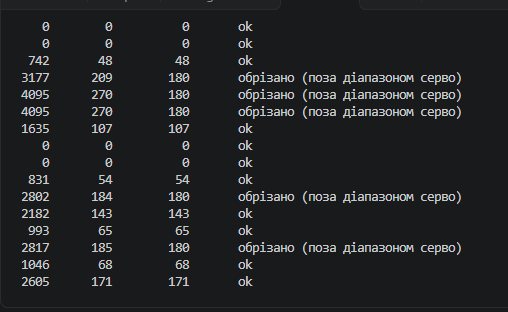

# Модуль 3.5 — Керування сервоприводом за допомогою PWM

Beetroot Academy, Embedded Development — Модуль 3, урок 5.

Потенціометр керує положенням валу сервоприводу SG90 **у пропорції 1:1**: поворот ручки на 1° — поворот валу на 1°.

Потенціометр має механічний хід ~270°, а сервопривід — 180°. Тому використовується лише
**спільна частина діапазону 0..180°**: коли ручка повернута далі за 180°, вал стоїть у крайньому
положенні 180°, а надлишок ходу обрізається. Кут відхилення від крайнього лівого положення
логується в серійну консоль.



Відео: [demo.mp4](demo.mp4)

## Обладнання
- ESP32-S3-DevKitC-1 (N16R8)
- Потенціометр 10 кОм
- Сервопривід Tower Pro SG90
- Зовнішнє джерело живлення 5 В для сервоприводу

## Підключення
| Компонент | Підключення |
|---|---|
| Потенціометр, крайній вивід 1 | **3V3** |
| Потенціометр, середній вивід | **GPIO4** (ADC1_CH3) |
| Потенціометр, крайній вивід 2 | **GND** |
| SG90, сигнал (помаранчевий) | **GPIO7** |
| SG90, живлення (червоний) | **+5 В** зовнішнього джерела |
| SG90, GND (коричневий) | **GND** джерела, з'єднаний з GND ESP32 |



Схема в симуляторі Wokwi (у симуляції серво живиться від 5V плати):



## Параметри
| Параметр | Значення |
|---|---|
| ADC | ADC1_CH3, 12 біт (0..4095), атенюація 11 dB, усереднення 16 відліків |
| Хід потенціометра | 270° |
| Хід серво | 180° |
| ШІМ серво | LEDC timer0 / ch0, 50 Гц (20 мс), 14 біт |
| Імпульс | 500 мкс = 0°, 2500 мкс = 180° |
| Межа спільного діапазону | RAW ≈ 2730 (= 4095 · 180 / 270) |
| Оновлення / лог | кожні 20 мс / кожні 200 мс |

## Алгоритм
```
pot_deg  = RAW * 270 / 4095              // фактичний кут ручки
srv_deg  = min(pot_deg, 180)             // 1:1 + обрізання до ходу серво
pulse_us = 500 + srv_deg * 2000 / 180
duty     = pulse_us * 16383 / 20000
```
Усі числа в коді винесені в іменовані константи (`POT_RANGE_DEG`, `SERVO_RANGE_DEG`, `SERVO_MIN_US` …).

## Програмна частина
- PlatformIO, фреймворк **ESP-IDF** 5.1
- `esp_adc/adc_oneshot.h` — читання потенціометра
- `driver/ledc.h` — ШІМ для сервоприводу

## Результати


```
RAW   pot(deg)   servo(deg)   стан
----------------------------------------
   0        0          0       ok
 831       54         54       ok
1635      107        107       ok
2405      158        158       ok
2605      171        171       ok
2802      184        180       обрізано (поза діапазоном серво)
3177      209        180       обрізано (поза діапазоном серво)
3715      244        180       обрізано (поза діапазоном серво)
4095      270        180       обрізано (поза діапазоном серво)
```

## Висновки
- У межах 0..180° кут серво дорівнює куту ручки потенціометра (1:1).
- Після ~180° ходу ручки (RAW > ~2730) вал залишається на 180°, решта ходу потенціометра не використовується.
- Сервопривід керується шириною імпульсу (0.5–2.5 мс) при частоті 50 Гц; 14-бітна роздільна здатність LEDC
  дає крок ≈ 1.2 мкс, тобто ≈ 0.1° — значно точніше, ніж потрібно для SG90.
- Сервопривід живиться від окремого джерела 5 В зі спільною землею, щоб не просаджувати живлення ESP32.
