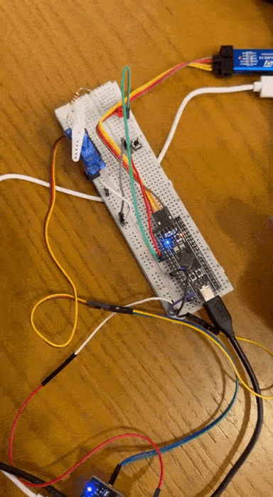

# STM32F411 — Керування сервоприводом та світлодіодами з обробкою кнопки

## Опис проєкту

Проєкт демонструє базову роботу з мікроконтролером **STM32F411CEU6** (WeAct Black Pill) з використанням **STM32 HAL**.

### Реалізовано:
- Неблокуюче керування сервоприводом (PWM)
- Обробка тактової кнопки з антидребезгом
- Керування вбудованим та зовнішнім світлодіодами
- Використання `HAL_GetTick()` замість `HAL_Delay()`

Проєкт може бути використаний як основа для більш складних систем позиціонування та індикації в embedded-пристроях.

## Апаратна частина

| Компонент               | Призначення             | Підключення                       |
|-------------------------|-------------------------|-----------------------------------|
| STM32F411CEU6           | Основний мікроконтролер | —                                 |
| Сервопривід SG90        | Позиціонування          | Сигнал → PA6 (TIM3_CH1)           |
| Тактова кнопка          | Керування режимом       | PA0 → кнопка → GND                |
| Світлодіод (вбудований) | Індикація               | PC13                              |
| Світлодіод (зовнішній)  | Індикація стану         | PA1 → резистор 220 Ом → LED → GND |

## Підключення

| Сигнал                | Пін STM32 | Примітка                           |
|-----------------------|-----------|------------------------------------|
| Кнопка                | PA0       | Внутрішня підтяжка (Pull-up)       |
| Зовнішній LED         | PA1       | Через струмообмежувальний резистор |
| Вбудований LED        | PC13      | На платі                           |
| Сервопривід (PWM)     | PA6       | TIM3 Channel 1                     |
| Живлення сервоприводу | 5V        | Окремий блок живлення              |
| Земля                 | GND       | Спільна земля                      |

## Логіка роботи

1. Після запуску система знаходиться у вимкненому стані.
2. Натискання кнопки вмикає систему:
   - Зовнішній світлодіод починає мигати
   - Сервопривід починає плавно рухатися
3. Повторне натискання кнопки вимикає систему:
   - Світлодіод гасне
   - Сервопривід повертається в початкове (центральне) положення

## Використані технології

- STM32 HAL
- PWM (TIM3)
- GPIO з внутрішньою підтяжкою
- Неблокуючий код на основі `HAL_GetTick()`
- Антидребезг кнопки

## Збірка та прошивка

1. Відкрити проєкт у **STM32CubeIDE**
2. Зібрати проєкт (**Build**)
3. Підключити плату по USB
4. Виконати прошивку (**Run**)

## Можливе розширення

- Додавання датчиків відстані (ToF / ультразвукові)
- Автоматичне супроводження цілі
- Вивід даних на OLED / TFT дисплей
- Робота з енкодером
- Перехід на FreeRTOS

## Навички, які демонструє проєкт

- Робота з STM32 HAL
- Налаштування таймерів та PWM
- Обробка кнопок та антидребезг
- Неблокуюче програмування
- Базова робота з сервоприводами
- Організація GPIO

