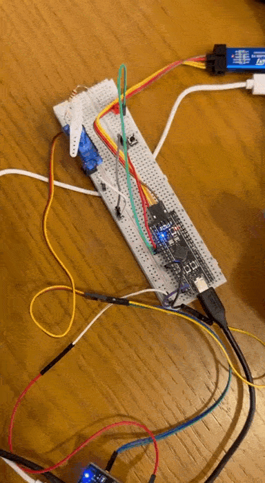

# STM32F411 — Керування сервоприводом та світлодіодами з обробкою кнопки

## Опис проєкту

Проєкт демонструє базову роботу з мікроконтролером **STM32F411CEU6** (WeAct Black Pill) з використанням **STM32 HAL**.

### Реалізовано:
- Неблокуюче керування сервоприводом (PWM)
- Обробка тактової кнопки: детект фронту з антидребезгом (одне натискання — одне перемикання)
- Керування вбудованим та зовнішнім світлодіодами
- Використання `HAL_GetTick()` замість `HAL_Delay()`

## Апаратна частина

| Компонент               | Призначення             | Підключення                       |
|-------------------------|-------------------------|-----------------------------------|
| STM32F411CEU6           | Основний мікроконтролер | —                                 |
| Сервопривід SG90        | Позиціонування          | Сигнал → PA6 (TIM3_CH1)           |
| Тактова кнопка          | Керування режимом       | PA0 → кнопка → GND                |
| Світлодіод (вбудований) | Індикація увімкнення    | PC13 (активний низький рівень)    |
| Світлодіод (зовнішній)  | Індикація стану         | PA1 → резистор 220 Ом → LED → GND |

## Підключення

| Сигнал                | Пін STM32 | Примітка                           |
|-----------------------|-----------|------------------------------------|
| Кнопка                | PA0       | Внутрішня підтяжка (Pull-up)       |
| Зовнішній LED         | PA1       | Через струмообмежувальний резистор |
| Вбудований LED        | PC13      | На платі                           |
| Сервопривід (PWM)     | PA6       | TIM3 Channel 1                     |
| Живлення сервоприводу | 5V        | Окремий блок живлення              |
| Земля                 | GND       | Спільна земля                      |

## Логіка роботи

1. Після запуску система знаходиться у вимкненому стані, серва в центрі (1500 мкс).
2. Натискання кнопки вмикає систему:
   - Вбудований світлодіод PC13 світиться
   - Зовнішній світлодіод мигає (перемикання кожні 300 мс)
   - Сервопривід плавно ходить між 1000 і 2000 мкс кроком 20 мкс кожні 20 мс
3. Повторне натискання кнопки вимикає систему:
   - Обидва світлодіоди гаснуть
   - Сервопривід повертається в центральне положення

Кнопка обробляється за фронтом: новий рівень приймається, якщо він стабільний
не менше 50 мс (`BTN_DEBOUNCE_MS`), і перемикання відбувається один раз на
натискання, навіть якщо кнопку тримати.

## Параметри

Усі константи — `#define` у блоці `USER CODE BEGIN PD` файлу `Core/Src/main.c`.

| Константа               | Значення | Призначення                                |
|-------------------------|----------|--------------------------------------------|
| `BTN_DEBOUNCE_MS`       | 50 мс    | Антидребезг кнопки                         |
| `LED_BLINK_TOGGLE_MS`   | 300 мс   | Інтервал перемикання зовнішнього LED       |
| `SERVO_STEP_PERIOD_MS`  | 20 мс    | Інтервал між кроками серви                 |
| `SERVO_PULSE_MIN_US`    | 1000 мкс | Крайнє положення серви                     |
| `SERVO_PULSE_MAX_US`    | 2000 мкс | Крайнє положення серви                     |
| `SERVO_PULSE_CENTER_US` | 1500 мкс | Центр, положення у вимкненому стані        |
| `SERVO_PULSE_STEP_US`   | 20 мкс   | Крок зміни імпульсу                        |

Тактування: HSI 16 МГц без PLL. TIM3: prescaler 15 → 1 МГц, period 19999 →
PWM 50 Гц, тому значення compare дорівнює ширині імпульсу в мікросекундах.
Налаштування таймера задані в `servoblink.ioc` і згенеровані CubeMX.

Код користувача розміщено лише між маркерами `USER CODE BEGIN/END`, тому
перегенерація з `servoblink.ioc` його не зітре.

## Використані технології

- STM32 HAL
- PWM (TIM3)
- GPIO з внутрішньою підтяжкою
- Неблокуючий код на основі `HAL_GetTick()`
- Антидребезг кнопки

## Збірка та прошивка

1. Відкрити проєкт у **STM32CubeIDE**
2. Зібрати проєкт (**Build**)
3. Підключити плату по USB
4. Виконати прошивку (**Run**)

## Навички, які демонструє проєкт

- Робота з STM32 HAL
- Налаштування таймерів та PWM
- Обробка кнопок: детект фронту та антидребезг
- Неблокуюче програмування
- Базова робота з сервоприводами
- Організація GPIO

